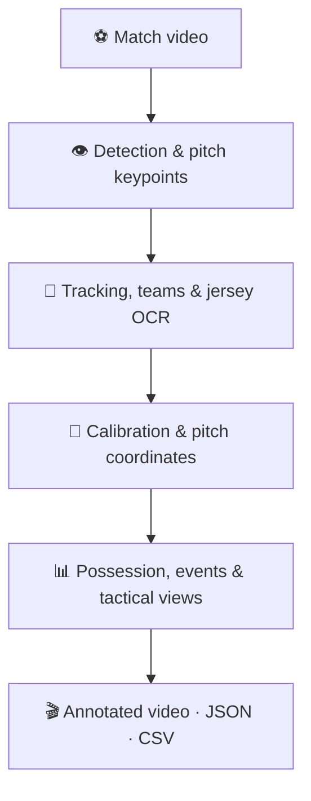

<h1 align="center">
  
</h1>

<h3 align="center">⚽ Sports AI · 👁️ Computer Vision · 📐 Geometric Vision · 🚀 GPU Inference</h3>

  Turning football video into player identities, pitch coordinates, events, and tactical insights.

  
  
  
  

  📍 Morocco 🇲🇦 · 🎓 Master's in Artificial Intelligence & Virtual Reality 
  🤝 Open to technical collaborations, applied research, and knowledge sharing

---

## 👨‍💻 About Me

I'm a Computer Vision Engineer with a Master's degree in **Artificial Intelligence and Virtual Reality** from **Ibn Tofail University, Kénitra**.

My work connects deep learning with geometry: detecting players and balls, maintaining identities through occlusion, calibrating cameras, projecting movement onto the pitch, and extracting information from video. I also work on the engineering that makes these pipelines practical: GPU inference, temporal consistency, model conversion, and performance evaluation.

Alongside my professional work, I develop **TactiVision**, an independent football video analytics R&D project.

## ⚽ TactiVision · My Sports AI Project

  
  

**From match footage to structured football intelligence.**

TactiVision is my independent R&D project combining **deep learning, tracking, geometric vision, and football analytics**. I build and evaluate the pipeline across tactical and broadcast video, connecting visual observations to player movement and game events.

<table>
<tr>
<td width="50%" valign="top">

### 👁️ Perception
- Player, goalkeeper, referee, and ball detection
- Pitch keypoints and field understanding
- Team color assignment and jersey OCR

</td>
<td width="50%" valign="top">

### 🏃 Tracking & Identity
- Multi-object tracking and player ReID
- Identity consistency through occlusion
- Recovery when players leave and return

</td>
</tr>
<tr>
<td width="50%" valign="top">

### 📐 Geometry & Spatial Analysis
- Camera calibration and homography
- Stable projection onto a top-down pitch
- Player trajectories and ball-height research

</td>
<td width="50%" valign="top">

### 📊 Events & Tactical Insights
- Possession, passes, shots, and interceptions
- Heatmaps, pass maps, and movement analysis
- Annotated video, JSON timelines, and CSV stats

</td>
</tr>
</table>

### 🔄 How the pipeline connects

### 🚀 Engineering behind the analysis
**TensorRT FP16 · CUDA streams · Parallel model inference · Batch ReID · OCR caching · Temporal smoothing**

The focus is on both useful football outputs and the engineering needed for stable results over time.

### 🔬 What I'm exploring next
- **Identity recovery:** combine tracking, jersey numbers, and ReID after long disappearances.
- **VLM-assisted recovery:** explore visual context as a fallback for difficult identity cases.
- **Camera motion:** improve calibration stability during pans and view transitions.
- **Longer sequences:** strengthen ball tracking, synchronization, and full-match reliability.

Independent research in active development, with evaluation on selected match sequences.

  
  

---

## 🎯 What I Work On

| Area | Focus |
| --- | --- |
| **Detection & segmentation** | Players, balls, referees, goals, pitch regions, and field keypoints |
| **Tracking & identity** | Multi-object tracking, player ReID, team assignment, and jersey OCR |
| **Geometric vision** | Camera calibration, homography, pitch projection, and 2D/3D spatial analysis |
| **Video understanding** | Possession, passes, shots, interceptions, goals, and temporal smoothing |
| **Inference & deployment** | TensorRT, ONNX, FP16, CUDA streams, batching, and pipeline profiling |
| **Analytics outputs** | Annotated video, trajectories, heatmaps, pass maps, JSON timelines, and CSV statistics |

## 💼 Career & Experience

### 🔒 Computer Vision Engineer · Company name withheld
**October 2026 – Present · 🇲🇦 Morocco**

Working on **3D football officiating and spatial analysis**, combining player and ball tracking, camera calibration, geometric vision, and reliable video-processing pipelines.

### 🌍 Computer Vision Engineer & Sports AI Consultant · Freelance
**July – September 2026 · Remote · 🇦🇺 Australia · 🇳🇿 New Zealand · 🇭🇷 Croatia**

**Clients: SolveXI, TechnologyOne, and other international clients**

- **SolveXI:** integrated SkillCorner tracking, events, and phase-of-play data into a tactical analysis pipeline. Produced coach-readable insights on team shape, width and depth, possession structure, passing options, pressing, and cross-match patterns.
- **TechnologyOne:** evaluated footage quality, detection and tracking feasibility, and camera-calibration requirements. Advised on architecture, model adaptation, Veo-camera workflows, and homography/pitch mapping.
- Provided technical advisory on system design, model selection, deployment, benchmarking, and development planning.
- Translated requirements into clear milestones, deliverables, implementation phases, and engineering recommendations.

**Tools:** Python · PyTorch · OpenCV · SkillCorner data · Multi-object tracking · Homography · Tactical analytics

### 🇺🇸 Priori Sports, Inc. · Computer Vision Engineer — Contract
**May – June 2026 · San Francisco, United States · Remote**

- Developed football spatial tracking components, including calibrated spatial projection and tracking-data processing.
- Built **ball-height and trajectory estimation** from 2D observations and camera-calibration data.
- Applied temporal smoothing, airborne detection, and spatial correction.

**Tools:** Python · OpenCV · Camera calibration · 3D geometry · NumPy · SciPy · Signal processing

### 🇫🇷 SportScore · Computer Vision Engineer — Freelance
**September – October 2025 · Paris, France · Remote**

Continued after the internship to restructure and optimize the inference pipeline.

- Separated model loading, preprocessing, inference, and postprocessing into independent stages.
- Reduced serial bottlenecks through parallel execution, CUDA streams, batched ReID, and asynchronous processing.
- Reduced processing time by **46.7%** on the measured test sequence.

**Tools:** TensorRT FP16 · CUDA streams · ONNX · PyTorch · Python

### 🇫🇷 SportScore · R&D Intern — Applied AI & Computer Vision
**April – September 2025 · Paris, France · Remote**

- Built a YOLO11 frame classifier with **99.95% accuracy** for main-view vs. other-view filtering.
- Developed player and ball detection, tracking, OSNet ReID, team assignment, jersey OCR, and pose components.
- Applied camera homography and geometric transformations for spatial analysis and pitch mapping.
- Implemented action analysis covering passes, shots, dribbles, interceptions, and goals.
- Delivered heatmaps, pass maps, structured JSON/CSV outputs, and match statistics.
- Worked autonomously and helped coordinate implementation and code consistency across the intern team.

**Tools:** Python · PyTorch · TensorFlow · OpenCV · YOLO · DeepSORT · OSNet · CUDA · TensorRT · Pandas · Docker · FastAPI

### 🇲🇦 Ibn Tofail University · SETIME Laboratory
**October 2024 – January 2025 · Kénitra, Morocco**

Built an end-to-end video event spotting workflow with **RegNet-Y, Gate Shift Modules, and Bi-GRU**, covering video extraction, annotation, training, and evaluation.

### 🇲🇦 Orange Business · CDN Security Engineering Internship
**September – November 2023 · Sala Al Jadida, Morocco**

Worked on secure content delivery, token-based URL generation, shell scripting, and CDN access controls.

## 📈 Selected Results

| Work | Reported result | Context |
| --- | --- | --- |
| **Futsal frame classification** | **99.95% accuracy** | Main-view vs. other-view classification; approximately 33% of frames filtered |
| **Pipeline parallelization** | **22m57s → 12m12s** | Same 1m14s test video; approximately 46.7% less processing time |
| **Futsal ball detection** | **90.1% precision · 83.4% recall · 83.4% mAP50** | Fine-tuned detector evaluation |
| **Video event spotting** | **0.93 recall** | DRIVE class in the university research project |

Results are specific to their evaluation datasets, hardware, and pipeline configurations. They are not general benchmarks or end-to-end accuracy claims.

## 🛠️ Tools & Software

  
  
  
  
  
  
  

| Category | Tools & methods |
| --- | --- |
| **Core development** | Python, C/C++, SQL, NumPy, Pandas, OpenCV, Git, Linux, Windows, Shell |
| **Deep learning** | PyTorch, Ultralytics YOLO — including YOLO11 and YOLO26, TensorFlow/Keras, scikit-learn |
| **Tracking & ReID** | ByteTrack, OC-SORT, DeepSORT, OSNet / Torchreid |
| **OCR & annotation** | PaddleOCR, EasyOCR, CVAT |
| **Calibration & geometry** | Field keypoints, RANSAC, homography, camera models, reprojection checks, temporal smoothing |
| **GPU inference** | TensorRT FP16/INT8, ONNX Runtime, CUDA streams, batching, caching |
| **Applications & deployment** | Docker, FastAPI, REST APIs, AWS S3/EC2 |
| **Sports data & analytics** | SkillCorner tracking/events/phase-of-play data, tactical analysis, Veo-camera workflows |
| **Mathematical methods** | Linear algebra, projective geometry, statistics, signal processing, SciPy |
| **Other project experience** | ROS2, Gazebo, LiDAR, reinforcement learning, CRNN-based OCR |

## 💡 Other Projects

| Project | Technical focus |
| --- | --- |
| **Tifinagh OCR** | Handwritten Amazigh character recognition, CRNN, and OCR workflows |
| **Autonomous navigation** | Reinforcement learning with TD3 and ROS2/Gazebo simulation |
| **Diabetic retinopathy classification** | EfficientNetB0, APTOS 2019, preprocessing, and augmentation |

## 🤝 How I Work

I enjoy turning an ambiguous video problem into an experiment with measurable results. My approach combines dataset preparation, model evaluation, visual debugging, and iteration on difficult sequences.

My experience also includes **mentoring interns, documenting methods, coordinating technical work remotely, and explaining model behavior and limitations**.

## 🎓 Education & Languages

**Master's in Artificial Intelligence and Virtual Reality**  
🇲🇦 Ibn Tofail University · Faculty of Sciences, Kénitra · 2023–2025

**Bachelor's in Physics — Theoretical & Mathematical**  
🇲🇦 Ibn Tofail University · Kénitra · 2020–2023

| Arabic | French | English |
| :---: | :---: | :---: |
| Native | Professional | Professional working proficiency |

<b>Additional certifications</b>

Skillsoft · November 2023

- Automation Testing for Python
- AI/ML Data Strategy
- Network Monitoring & Remote Access

## 📊 GitHub Activity

  

## 🌐 Let's Connect

Interested in **computer vision, sports technology, geometric vision, or efficient video inference**? I'm happy to exchange ideas and discuss relevant technical collaborations.

**[Portfolio](https://mehdihch.github.io/PortfolioMCH/)** · **[LinkedIn](https://www.linkedin.com/in/elmehdihicham/)** · **[Email](mailto:mehdihicham736@gmail.com)**

Last updated: November 2026

  

